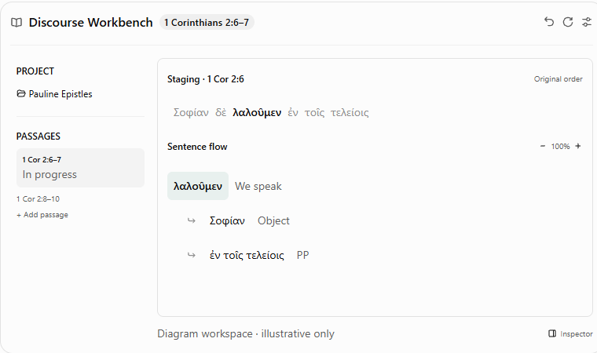
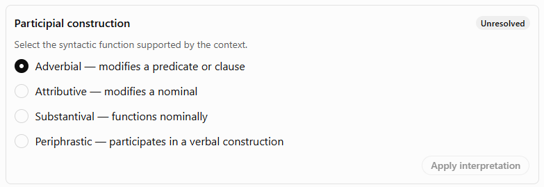
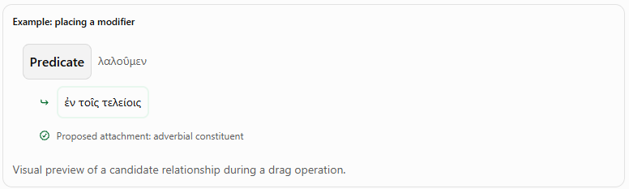
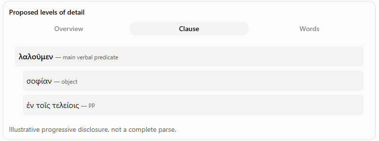
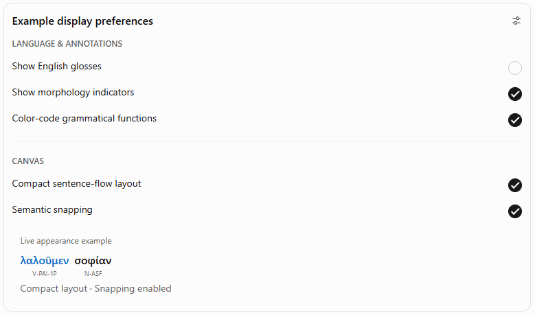

# Biblical Discourse Analysis Workbench

## Overview

| Item | Specification |
| --- | --- |
| Status | Proposed specification, v0.1; multilingual and discourse-outline requirements added |
| Application type | Single-page Progressive Web App (PWA) |
| Working texts | Selectable English translation, SBL Greek New Testament (SBLGNT), and Hebrew source text; WLC with OSHB annotations is a candidate Hebrew source |
| Primary analysis method | Fee-inspired sentence flow, extended with explicit discourse relationships |
| Canonical data format | JSON-LD / RDF |
| Exports | JSON-LD, Turtle, Mermaid, SVG, and PNG; priorities are specified in §4.6 |
| Persistence | IndexedDB, using existing project infrastructure |
| Deployment | Static hosting with client-side processing |

This document separates user requirements, technical capabilities, and UI expectations. The original requirement IDs and priorities are retained. Requirements added from the multilingual and discourse-outline discussion begin at UR-49 and have milestone priority TBD. Recommendations, illustrative examples, and unresolved decisions are identified separately.

The source comparison in Appendix A identifies details from `DA-Spec_000.md` that remain implicit, missing, or intentionally refined. Those notes are not newly adopted requirements.

## 1. Product vision

The application enables students, pastors, teachers, and biblical scholars to perform discourse analysis of biblical passages in English, Greek, Hebrew, and relevant Aramaic passages through an interactive visual workspace. The passage remains the navigation anchor while users choose a working edition and optional supporting-language displays.

Users begin with biblical text in its original word order. The application performs as much grammatical structuring as its available data and rules justify, presenting the resulting analysis in a visual sentence-flow diagram.

Users can then refine the structure through direct manipulation: dragging words and phrases, assigning syntactic functions, identifying modifications, grouping constituents, and relating propositions through discourse relations.

The application records the explicit grammatical, semantic, and discourse relationships represented by the user's analysis, rather than preserving only the visual appearance of the diagram.

### Primary design principles

1. **Semantic-first editing**: Visual arrangement represents meaningful relationships. The underlying relationships are saved explicitly in RDF.
2. **Human-guided analysis**: Automation proposes structures without pretending to resolve genuine linguistic ambiguity.
3. **Progressive disclosure**: The user sees only the information needed for the current task, with additional grammatical information available on demand.
4. **Direct manipulation**: Moving, grouping, nesting, and connecting objects should be easier than filling out forms.
5. **Textual fidelity**: Each source edition’s text, word order, token identities, and textual references remain intact. Changing the displayed language does not silently change the analysis basis.
6. **Separation of analysis and presentation**: Users may change a diagram's appearance without unintentionally changing its interpretation.
7. **Local-first operation**: No account, server, or cloud storage is required for normal operation.
8. **Extensibility**: The application should accommodate new linguistic annotations, discourse relations, and visualization modes without redesigning its underlying data model.

## 2. Architectural recommendations

Use a three-panel application shell with a collapsible left drawer, a central workspace, and an optional right inspector. Supplement the inspector with a compact contextual toolbar so that the canvas can use nearly the full window width when needed.

The preferred renderer combines SVG with native HTML/DOM text. This is a specialized structured-text editor: indentation, alignment, grouping, and word order carry meaning. The semantic layout engine is therefore more important than a general-purpose graph-drawing library. Rendering options and tradeoffs are detailed in §9.

Reuse the existing project-persistence, RDF, and Mermaid adapters where practical. The existing SBLGNT JSON source and the availability of linguistic annotations must be distinguished: that source text is available, while English and Hebrew source packages, alignment coverage, glosses, and morphological annotations must be identified and verified separately. Use edition adapters rather than assuming all texts share a tokenizer, versification, or grammatical annotation scheme.

## 3. Proposed user interface

The visual direction should resemble a modern writing or design application rather than a traditional Bible-study website: restrained colors, generous spacing, legible English, Greek, and Hebrew typography, subtle borders, and minimal visual clutter.

**Draft UI wireframe**



*This is a compact conceptual layout, not a syntactic analysis of the full passage. The inspector is collapsed in this view.*

The following requirements formalize this approach.

## 4. Functional requirements and acceptance criteria

The following requirements are grouped by user-facing functionality. Each distinguishes the user's goal from the technical behavior necessary to fulfill it.

**Priority legend**

- **P0 — MVP:** Required for the minimum viable product.
- **P1 — First enhancement:** Planned after the MVP.
- **P2 — Future:** A later extension.
- **TBD — Milestone unassigned:** An added requirement whose implementation priority has not yet been agreed. TBD does not mean the requirement is optional.

The section-level acceptance criteria describe the intended behavior of the listed capabilities. Some combine P0 and P1 features; implementation milestones need separate acceptance gates, as noted in §18.1.

### 4.1 Project and passage management

| ID | User requirement | Technical capability | Priority |
| :---: | :--- | :--- | :---: |
| UR-01 | Create, name, open, and delete projects | Existing IndexedDB project adapter | P0 |
| UR-02 | Select a biblical book, chapter, and verse range | Scripture reference navigator | P0 |
| UR-03 | Add one or more passages to a project | Passage ingestion and source tracking | P0 |
| UR-04 | Resume an unfinished analysis | State persistence and restoration | P0 |
| UR-05 | Export and import the analysis | Existing JSON-LD/RDF adapters | P0 |
| UR-06 | Work offline after installation | Service worker and local assets | P1 |
| UR-07 | Maintain separate analyses of the same passage | Independent analysis document IDs | P1 |
| UR-49 | Keep the same biblical passage in view when changing editions or languages | Stable passage anchors, explicit versification identifiers, and edition-specific reference mappings | TBD |

**Acceptance criteria**: A user can create a project, import `1 Corinthians 2:6–7`, begin analyzing it, close the application, and reopen the project with all annotations, relationships, and layout intact.

A passage reference is a navigation anchor, not a sufficient token or proposition identity. A project records its selected editions, annotation packages, analysis basis, and supporting display preferences so they can be restored together.

**Additional acceptance criteria**: Changing the working edition preserves the selected passage and its analysis document. Where verse numbering differs, the application displays the mapped reference or an explicit unresolved mapping rather than silently selecting different material.

### 4.2 Biblical text staging

| ID | User requirement | Technical capability | Priority |
| :---: | :--- | :--- | :---: |
| UR-08 | View the selected edition in its source word order | Immutable, edition-specific source token sequence | P0 |
| UR-09 | Stage verses or selected spans | Token-range staging component | P0 |
| UR-10 | Distinguish assigned from unassigned words | Token assignment state | P0 |
| UR-11 | See a word’s lemma, morphology, part of speech, and Strong’s references where available | Sourced, language-specific token metadata lookup with explicit missing values | P1 |
| UR-12 | Show or hide supporting-language glosses | Configurable gloss/interlinear presentation layer, including English support for Greek/Hebrew and aligned original-language support for English | P1 |
| UR-13 | See remaining unanalyzed material | Token coverage calculation | P0 |
| UR-14 | Analyze passages spanning multiple verses | Verse-independent span and clause model | P0 |
| UR-50 | Inspect words and their annotated subword units without losing the source text | Edition-specific token and morpheme identities with ordered membership and links to the original word | TBD |
| UR-51 | Distinguish unavailable metadata from a word with no applicable annotation | Coverage/status fields and provenance for lemma, gloss, morphology, part of speech, and lexical-reference assertions | TBD |

**Acceptance criteria**: Staging a passage retains its original order. When a user assigns a word to a grammatical constituent, that word remains visible in staging but becomes visually de-emphasized. Removing the assignment restores its prominence.

A token should be allowed to participate in multiple levels of structure. For example, a word can belong to a prepositional phrase, which belongs to an adverbial constituent, which modifies a verbal predicate. The staged token should not be considered missing or duplicated because of this nesting.

Display a lexical gloss, an actual translated passage, and an alignment as distinct kinds of information. A part-of-speech annotation is not the same as a user-assigned syntactic role. Strong’s references identify lexical resources; they are not unique token IDs or sufficient evidence that two expressions align.

**Additional acceptance criteria**: Selecting an annotated Hebrew word can expose its prefixes or other supplied morphemes while preserving the complete source word. A token with missing morphology or gloss data remains usable and is labeled as unavailable rather than receiving an invented annotation.

### 4.3 Automatic sentence-flow construction

| ID | User requirement | Technical capability | Priority |
| :---: | :--- | :--- | :---: |
| UR-15 | Generate an initial sentence-flow diagram | Rule-based syntax proposal engine | P0 |
| UR-16 | Establish clause structure automatically when supported | Clause and predicate identification | P0 |
| UR-17 | Recognize candidate subjects, objects, and modifiers | Morphology-assisted role assignment | P1 |
| UR-18 | Identify constituent boundaries | Phrase detection and grouping | P1 |
| UR-19 | Preserve uncertainty rather than guessing | Candidate interpretations and unresolved state | P0 |
| UR-20 | Override an automatic interpretation | Editable role and relation assertions | P0 |
| UR-21 | Distinguish automatic suggestions from user decisions | Provenance and review status tracking | P0 |
| UR-52 | Receive only grammatical suggestions applicable to the analysis language | Language- and annotation-scheme-specific rule modules with declared input prerequisites and supported constructions | TBD |

**Acceptance criteria**: Given a morphologically annotated passage, the application identifies what can be established with available rules and data, then presents unresolved choices without silently committing to an interpretation.

The rule engine should distinguish three cases:

- **Determined**: A structural conclusion follows from the available annotations and rules.
- **Suggested**: One or more interpretations are plausible, but the data does not determine a unique analysis.
- **Unresolved**: The program cannot identify a sufficiently supported relationship.

Morphological parsing is not equivalent to syntactic parsing. The application must never assume that a Greek nominative is necessarily the subject, an accusative necessarily the direct object, or a participle necessarily adverbial.

English, Greek, Hebrew, and Aramaic rules are separate capabilities. The application must not copy Greek grammatical assumptions onto English or Hebrew text, or infer a syntactic parse merely because morphology is available. Absence of a supported rule leaves an analysis unresolved and editable.

**Additional acceptance criteria**: With the analysis basis set to Hebrew, an unsupported construction remains unresolved; Greek-only rules do not execute. Switching only the supporting display language leaves accepted grammatical assertions unchanged.

### 4.4 Manual grammatical analysis

| ID | User requirement | Technical capability | Priority |
| :---: | :--- | :--- | :---: |
| UR-22 | Drag words into grammatical positions | Token-to-constituent drag-and-drop | P0 |
| UR-23 | Group words into phrases | Constituent creation and token membership | P0 |
| UR-24 | Assign subject, predicate, object, and other roles | Typed syntactic relationships | P0 |
| UR-25 | Specify what a modifier modifies | Dependency assignment | P0 |
| UR-26 | Treat adjectives substantively, attributively, or predicatively | Typed interpretive functions | P1 |
| UR-27 | Analyze participles with competing functions | Function-selection rules | P1 |
| UR-28 | Identify implied subjects and ellipses | Implicit constituent support | P1 |
| UR-29 | Undo, redo, and revise decisions | Command history and reversible mutations | P0 |
| UR-30 | Add grammatical notes | Annotation entities | P1 |
| UR-53 | Distinguish changing the display language from starting an analysis of another edition’s syntax | An explicit analysis-basis field and a deliberate create/copy-analysis workflow for a new edition or language | TBD |
| UR-81 | Reuse an understood subject, predicate, object, or other constituent in propositions where it is not repeated in the text | Stable constituent identities plus proposition-role assertions that distinguish explicit realization from implicit reuse | TBD |

**Acceptance criteria**: The user can create a phrase, assign an adjective to modify its head, change the adjective's interpretation, and see the sentence-flow layout update without losing the original source text.

A Greek syntactic analysis displayed alongside aligned English is still a Greek analysis. An analysis made directly on an English translation has its own syntactic assertions and source anchors. Any copied or suggested relationships are reviewable candidates rather than automatically accepted equivalents.

**Additional acceptance criteria**: Switching the visible text from Greek to aligned English does not relabel Greek dependencies as English syntax. Starting an English-based syntactic analysis creates or explicitly selects a separate analysis while retaining the existing Greek analysis.

A reused constituent is one canonical grammatical entity, not a copied source token and not parenthetical text inserted into the edition. Each proposition-role assertion records both the grammatical role and whether the constituent is explicitly realized in that proposition or supplied implicitly by ellipsis. The same mechanism applies to subjects, predicates, objects, determiners, and other supported roles rather than introducing a special-purpose “implied subject” field.

### 4.5 Proposition and discourse analysis

Proposition and discourse analysis form a distinct capability layer. A syntactic clause is not always equivalent to a proposition, and a single clause can express more than one proposition.

| ID | User requirement | Technical capability | Priority |
| :---: | :--- | :--- | :---: |
| UR-31 | Identify propositions | Proposition creation and text anchoring | P0 |
| UR-32 | Link propositions | Typed discourse relation entities | P0 |
| UR-33 | Identify cause, purpose, condition, and concession | Controlled relation vocabulary | P0 |
| UR-34 | Represent coordination and subordination | Syntactic and discourse hierarchy support | P0 |
| UR-35 | Connect propositions from different verses | Cross-span relationship engine | P0 |
| UR-36 | Distinguish discourse functions from grammatical dependencies | Separate relation namespaces | P0 |
| UR-37 | Organize propositions into larger argument units | Nested discourse segments | P1 |
| UR-38 | Trace and highlight an argument's structure | Relation traversal and visual highlighting | P1 |
| UR-54 | Keep a proposition identifiable across supported edition views | Stable proposition IDs with separately sourced, edition-specific token-span anchors and mapping status | TBD |
| UR-55 | Relate whole discourse segments as well as individual propositions | Stable discourse-segment entities with explicitly ordered proposition/segment membership | TBD |
| UR-56 | Record additional relationships when a proposition participates in more than one argument | A semantic directed graph supporting multiple incoming/outgoing relations independently of the primary display hierarchy | TBD |
| UR-57 | Understand the direction and function of each discourse relationship | Defined relation types, source/target endpoints, participant roles, and an accessible label/abbreviation legend | TBD |
| UR-82 | Use conjunctions, particles, prepositions, and similar expressions as cues that anchor a proposition or discourse relationship | Non-exclusive source-token anchors with a typed cue function, kept distinct from proposition token coverage and relation semantics | TBD |

**Acceptance criteria**: A user can assert that Proposition B gives the reason for Proposition A, change that relation to an explanation or evidence relation, and export the resulting assertion as RDF independently of the diagram coordinates.

A proposition may occupy part of a verse or cross verse boundaries. Display labels such as “3a” or “3b” are references, not canonical proposition IDs. Group membership, semantic edge direction, and a group’s visual indentation are separate properties. Existing UR-37 retains its P1 priority; the milestone for the expanded segment requirements remains TBD.

**Additional acceptance criteria**: A user can connect two propositions, then connect a proposition to a larger segment, with explicit relation direction in RDF. A proposition with a second semantic parent remains one canonical proposition. If another edition expresses the content differently, its textual anchor can remain uncertain without deleting the proposition or fabricating an exact match.

A connective cue may be inside a proposition’s textual span, adjacent to it, or shared by a larger construction. Marking it as an anchor does not assign the token a second time and does not by itself assert a particular discourse relation. For example, Greek `δέ` can anchor a proposition while its contrastive, continuative, or other discourse function remains an explicit, reviewable interpretation.

### 4.6 Visualization and export

| ID | User requirement | Technical capability | Priority |
| :---: | :--- | :--- | :---: |
| UR-39 | Zoom, pan, and fit the diagram to view | Viewport controller | P0 |
| UR-40 | Snap objects to syntactically meaningful positions | Semantic layout engine | P0 |
| UR-41 | Collapse lengthy subordinate structures | Hierarchical constituent rendering | P0 |
| UR-42 | Select and move grouped structures | Nested layout manipulation | P0 |
| UR-43 | Show and hide annotations and glosses | Configurable rendering layers | P1 |
| UR-44 | Export JSON-LD and Turtle | Existing RDF adapters | P0 |
| UR-45 | Export and preview Mermaid | Existing Mermaid adapter | P1 |
| UR-46 | Export PNG | SVG rasterization | P1 |
| UR-47 | Export vector SVG | SVG serialization | P1 |
| UR-48 | Maintain a consistent appearance in light and dark modes | Theme tokens and rendering rules | P1 |
| UR-58 | Keep brackets, connectors, and labels aligned as text display changes | Text measurement and incremental layout invalidation after wrapping, language/font changes, gloss toggling, and collapsing | TBD |
| UR-59 | Export the diagram’s selected language, detail level, and primary outline consistently | An export renderer consuming the same semantic graph and resolved outline/layout as the interactive view | TBD |
| UR-60 | Group and attach propositions without relying on a mouse | Keyboard equivalents for selecting ranges, grouping segments, choosing primary attachments, and confirming semantic edits | TBD |

**Acceptance criteria**: A user can create a diagram, collapse two long phrases, switch to dark mode, and export the same analysis into JSON-LD, Turtle, and Mermaid. RDF exports preserve semantic structure; graphical exports preserve as much of the chosen visualization as the format supports.

The primary non-crossing outline is specified in §4.9. A language or font change may alter block height and connector geometry, but must not alter passage order, proposition identity, or semantic relation direction. Graphical exports preserve the selected view within the format’s capabilities; JSON-LD/Turtle preserve the full graph and its additional relationships even when those are not drawn in the primary outline.

**Additional acceptance criteria**: Change an English view to Hebrew with English glosses, resize the window, collapse a segment, and export. Text remains readable, primary connectors avoid text and labels, and the primary outline has no connector crossings. RDF round-tripping retains relationships not shown in that view. Mermaid exports disclose any layout limitations instead of promising identical manual placement.

### 4.7 Working editions, supporting languages, and alignment

Users choose a working edition independently from its supporting-language displays. English, Greek, and Hebrew are first-class working-text choices; selecting a language does not imply that all editions, annotations, or alignments are already available.

| ID | User requirement | Technical capability | Priority |
| :---: | :--- | :--- | :---: |
| UR-61 | Choose an English, Greek, or Hebrew edition as the primary working text | An edition registry and source adapters with edition/version IDs, language, reference scheme, dataset provenance, and capability/coverage metadata | TBD |
| UR-62 | Choose gloss, interlinear, or parallel text independently of the working edition | Separate supporting-display settings and identified source datasets for each language/edition pair | TBD |
| UR-63 | Highlight corresponding words or phrases across supported texts | Explicit many-to-many alignments between edition-specific ordered token spans, including discontinuous spans | TBD |
| UR-64 | Switch edition views without losing propositions, relationships, notes, or selection | Stable analysis identities, separate edition anchors, and restoration of the active selection through verified mappings | TBD |
| UR-65 | See incomplete, ambiguous, omitted, or variant correspondences honestly | Alignment status, provenance, review state, and explicit unmapped spans; parallel-text fallback when reliable interlinear alignment is unavailable | TBD |
| UR-66 | Know which text and annotation sources can be used and redistributed | Separate license, attribution, version, and provenance records for text, morphology, glosses, lexical mappings, alignments, and fonts | TBD |

**Data and interaction constraints**

- An edition’s source tokens are immutable and edition-specific. Preserve supplied stable IDs, or generate stable IDs tied to a particular dataset version; do not identify tokens solely by spelling, position in another edition, or Strong’s number.
- A passage anchor includes a reference scheme. Mapping across schemes or editions may be one-to-many or unresolved; a book/chapter/verse string alone is not a universal identity.
- A proposition’s edition anchors are separate assertions. Language switching does not imply identical word order, clause boundaries, proposition boundaries, or textual readings across translations.
- Alignment relates spans on both sides; it is not a required one-to-one lookup. Record its source and review status. Lexical glossing is not automatically a translation alignment.
- A translation need not be based on the selected Greek or Hebrew edition. Differences remain visible and must not be silently normalized away.
- Supporting original-language text under English is displayed from an identified aligned source. Do not generate an alleged original token by reversing an English gloss.
- Missing data is explicit. Source packages are usable without complete morphology, Strong’s mappings, or interlinear alignments; unavailable capabilities are explained in the UI.
- Changing display settings does not mutate accepted syntactic or discourse assertions. Changing the analysis basis is a separate user action under UR-53.

**Acceptance criteria**: For a passage with supplied alignment, switch English → SBLGNT → English and confirm unchanged proposition IDs, relationships, notes, and selection. A many-to-many phrase mapping highlights all and only its mapped spans. For an unmapped or variant expression, the UI shows an unresolved correspondence or parallel text. Save/reopen and JSON-LD round-trip preserve edition IDs, reference mappings, analysis basis, alignments, and their provenance.

### 4.8 Hebrew, Aramaic, and bidirectional text

Hebrew support includes the source model, linguistic annotations, interaction, and export—not merely a right-to-left font. Westminster Leningrad Codex (WLC) with Open Scriptures Hebrew Bible (OSHB) annotations is a candidate source package. “SBL Hebrew” identifies a font and must not be used as the source-edition identifier.

| ID | User requirement | Technical capability | Priority |
| :---: | :--- | :--- | :---: |
| UR-67 | Read and edit Hebrew alongside English, Greek, references, and relation labels | Correct right-to-left text runs, bidirectional isolation, per-run language/direction metadata, and Unicode-aware selection | TBD |
| UR-68 | Show or hide Hebrew vowel points and cantillation marks | Reversible display filters over an unchanged source string, with search/display normalization stored separately | TBD |
| UR-69 | Inspect supplied written/read alternatives and their annotations | Separate anchored qere/ketiv or other source-provided reading alternatives without overwriting either reading | TBD |
| UR-70 | Use appropriate scaffolding in Aramaic portions of the Hebrew Bible | Per-token language identifiers and explicit annotation/rule coverage for Hebrew and Aramaic | TBD |
| UR-71 | Use readable, correctly rendered Hebrew in the editor and exports | Tested font shaping, combining-mark handling, cursor/selection behavior, line height, and separately verified font distribution/embedding permissions | TBD |

**Data and interaction constraints**

- Preserve exact source text and distinguish words from their provider-supplied morphemes. Toggling pointing or cantillation must not create new token IDs or alter membership in an analysis.
- Do not apply a universal Unicode-normalization policy blindly to imported Hebrew data. Retain source strings and dataset-specific normalization rules; use derived search keys where needed.
- Keep source-provided reading alternatives, their provenance, and the user’s selected analysis reading explicit. Annotation coverage can differ between readings.
- Hebrew/Aramaic lexical identifiers must remain distinguishable from Greek identifiers, including any provider-specific extensions to Strong’s references.
- Grammatical rules and parts-of-speech vocabularies are language-specific. Missing Hebrew or Aramaic annotations are not filled by mechanically reusing Greek or English tags.
- Isolate left-to-right numbers and identifiers within right-to-left text. Selections must not split a displayed combining-character sequence.
- Text direction, passage ordering, semantic edge direction, and the side of the bracket gutter are independent settings. Switching to Hebrew must not unexpectedly mirror the entire diagram.

**Acceptance criteria**: Stage a Hebrew passage with English support, select a word and its supplied morphemes, inspect metadata, toggle pointing/cantillation, and export SVG/PNG. Stored text, IDs, and attachments remain unchanged. Mixed-direction verse references and labels remain legible. A supplied written/read alternative remains separately identifiable, and an Aramaic token exposes its actual language and available annotation coverage.

### 4.9 Non-crossing proposition outline and bracketed discourse view

The full analysis is a semantic directed graph. Its default bracketed discourse view is a separate, ordered primary outline. The reference style places propositions in passage order and uses nested brackets to connect propositions or larger segments. A general directed graph cannot always be drawn as one non-crossing bracket hierarchy while preserving that order; additional relations therefore need an explicit alternate presentation.

| ID | User requirement | Technical capability | Priority |
| :---: | :--- | :--- | :---: |
| UR-72 | Read propositions in stable passage order in a bracketed discourse outline | An explicit order over displayed proposition occurrences, independent of free coordinates and translated word order | TBD |
| UR-73 | Assign an unambiguous primary attachment for each displayed occurrence | An acyclic primary forest with at most one primary parent per occurrence; disconnected roots are permitted | TBD |
| UR-74 | Group consecutive propositions into larger discourse units | Explicit segment membership and order, with contiguous primary spans and independently identified group entities | TBD |
| UR-75 | Nest or juxtapose groups without crossing their brackets | Laminar primary spans: groups are disjoint or nested; partial overlap is rejected from the primary outline | TBD |
| UR-76 | Choose a primary display attachment without losing other semantic relationships | Separate primary-outline attachments and full graph relations, with user-selected primary placement | TBD |
| UR-77 | Inspect secondary or non-projective relationships without cluttering the primary outline | Selectable cross-references, focused relation views, or clearly linked occurrences of an existing proposition | TBD |
| UR-78 | Preview a grouping or attachment and understand why a placement is invalid | Semantic snap preview, confirmation, overlap/cycle validation, and an explanatory alternate-action prompt | TBD |
| UR-79 | Keep brackets, relation labels, and text separate and readable | Computed bracket lanes, measured label clearance, reserved text gutters, and deterministic connector routing | TBD |
| UR-80 | Control bracket orientation independently from the working language | Explicit gutter-side preference and direction-aware anchor calculations without reordering propositions or reversing relation meaning | TBD |

**Data and interaction constraints**

- Keep four structures distinct: the full semantic graph, ordered segment membership, the primary display forest, and resolved geometry. Store semantic source/target endpoints and participant roles explicitly; do not derive them from indentation or arrow orientation.
- Every displayed occurrence references one canonical proposition or segment. A linked second occurrence is not a new proposition and must not be counted as additional source coverage or silently create another semantic assertion.
- The primary forest has no self-parenting or cycles. A semantic relation type may have its own cycle constraints; do not apply the primary-tree restriction to every possible annotation or cross-reference.
- Every primary group covers a consecutive interval of displayed proposition occurrences. Children of a group follow that order and do not partially overlap. Group spans are nested or disjoint. Coextensive nested groups require explicit, distinct hierarchy levels and must never create a cycle.
- For example, groups over propositions 1–3 and 2–4 cannot both be sibling groups in the same primary outline. The UI explains the overlap and offers regrouping or a secondary-relation view; it does not erase a valid linguistic assertion.
- Discontinuous source spans and non-projective semantic relationships remain valid model data where allowed by the relevant analysis rules. They are not silently forced into contiguous primary groups.
- The default outline guarantees no proper crossings between unrelated primary connector paths and no connector intersections with text or labels. Intentional joins between connected bracket parts are allowed and must be distinguishable from crossings. Assign distinct lanes and clearance to nested brackets.
- Recompute geometry after text wrapping, edition/language changes, font loading, gloss toggling, resizing, and collapsing. Stable passage order, identities, relation direction, and the selected primary attachments do not change during reflow.
- Additional semantic parents require an explicit primary-placement choice for this view. Additional relationships remain accessible and exportable; do not silently drop them or invent a different interpretation to make the drawing fit.
- Free positioning cannot bypass these primary-outline invariants. Imports and restored layouts are validated against them, with recoverable diagnostics rather than destructive correction.
- UI labels and abbreviations have an accessible legend. Keyboard grouping and attachment operations perform the same validation and preview/confirmation as pointer operations.

**Acceptance criteria**: Create a nested, passage-ordered bracket diagram with relations between both propositions and segments. Adding groups over 1–3 and 2–4 produces an explanatory choice, not a crossed bracket or a lost assertion. Add a second semantic parent to one proposition: the graph preserves both relationships while the user chooses the primary attachment. Reflow after English/Greek/Hebrew switching, resizing, font changes, and collapsing keeps the primary outline free of connector crossings and text/label collisions. A linked occurrence retains the original proposition ID. RDF preserves the complete graph; SVG/PNG reproduce the selected valid outline, with any other export limitations disclosed.

## 5. The semantic model

The semantic model distinguishes six conceptual layers. Their separation is an architectural requirement.

| Layer | Scope | Examples |
| --- | --- | --- |
| 1. Textual source | Source text and linguistic metadata | Passage, verse, token, lemma, morphology |
| 2. Syntactic analysis | Grammatical structure | Clause, constituent, head, dependency, grammatical role |
| 3. Proposition analysis | Interpreted propositional content | Proposition, predicate, participant, qualification |
| 4. Discourse analysis | Relationships between propositions and segments | Explanation, cause, purpose, condition, contrast |
| 5. Diagram layout | Placement and compaction | Coordinates, indentation, ordering, grouping, collapse state |
| 6. Presentation preferences | Display choices | Colors, glosses, highlights, fonts, visible notation |

These are distinct model layers, not necessarily separate stores. They can all be represented in the same JSON-LD project document. The textual-source layer includes editions, reference mappings, and cross-edition alignment assertions. Syntactic assertions retain their analysis basis. The discourse graph and the primary bracket-outline projection remain separate structures under §4.5 and §4.9.

### 5.1 Why distinguish them?

Consider the words ἐν τοῖς τελείοις in 1 Corinthians 2:6.

They are a textual span containing three tokens. They may be analyzed as a prepositional phrase serving an adverbial function. The phrase can be visually indented below the clause predicate.

Those are at least four different assertions:

1. The phrase has three textual tokens in a specified order.
2. The phrase is a syntactic constituent.
3. The constituent has an adverbial function associated with the clause predicate.
4. The constituent is visually rendered at a certain indentation and position.

The first three are textual or linguistic claims. The fourth is a presentation choice that reflects those claims.

The fundamental rule should be that graphical placement helps create and display semantics, but coordinates are not themselves the authoritative semantic model.

For example, a user may move a phrase 12 pixels to the right to improve readability. That should not automatically create a new grammatical dependency.

### 5.2 Suggested entity types

| Entity | Purpose |
| --- | --- |
| Passage | Selected biblical textual range |
| TextEdition | Identified text dataset, version, language, reference scheme, and provenance |
| PassageAnchor | Stable navigation reference with edition-specific mappings |
| Token | Word or other token in the source edition |
| Morpheme | Provider-supplied subword unit linked to its source word |
| TextAlignment | Sourced mapping between edition-specific token spans |
| LinguisticAnnotation | Sourced gloss, morphology, part-of-speech, or lexical-reference assertion |
| TokenSpan | Ordered selection of tokens |
| Constituent | Grammatical grouping or unit |
| Clause | Clause-level syntactic unit |
| SyntacticDependency | Relationship between grammatical units |
| Proposition | Interpreted propositional content |
| DiscourseSegment | Identified, ordered grouping of propositions or smaller segments |
| DiscourseRelation | Relationship between propositions or discourse segments |
| AnalysisAssertion | An interpretation with source, status, and provenance |
| DiagramNode | Visual occurrence referencing a canonical linguistic entity |
| PrimaryOutlineAttachment | Chosen parent/child relationship in the non-crossing display forest |
| LayoutConstraint | Meaningful positional constraint |
| Annotation | User note or interpretive comment |
| AnalysisDocument | A particular user's analysis of a passage |

A proposition should be its own object. A diagram node should reference a proposition or constituent, not replace it.

### 5.3 RDF vocabulary design

The recommended vocabulary uses a small application namespace, such as `da:`, rather than forcing these distinctions into BFO or CCO classes without a direct linguistic equivalent.

Possible predicate names include the following. This is an illustrative list, not a complete Turtle document.

```text
da:hasConstituent
da:containsToken
da:hasSyntacticHead
da:hasGrammaticalFunction
da:hasRealizationStatus
da:hasSourceAnchor
da:hasCueFunction
da:dependsOn
da:expressesProposition
da:hasDiscourseRelation
da:sourceProposition
da:targetProposition
da:hasRelationType
da:hasInterpretationStatus
da:hasDiagramNode
da:hasLayoutConstraint

```

The vocabulary can later be aligned with an established linguistic ontology such as OntoLex-Lemon or a syntactic annotation standard where appropriate. There is no need to make that alignment a prerequisite of the MVP.

### 5.4 Identity and source anchoring

Each token should have a stable identifier incorporating its textual edition, biblical reference, and token position.

For example, token identifiers could be:

```text
sblgnt:1Cor.2.6.t01
sblgnt:1Cor.2.6.t02
sblgnt:1Cor.2.6.t03

```

Token identity must not depend solely on its spelling or Strong’s number. Identical words may occur multiple times in a verse.

The analysis records the edition or dataset version so that revisions to imported source material cannot silently shift annotations to different tokens. Passage references include their reference scheme. Cross-edition alignments and proposition anchors are separately sourced assertions; a verse match alone does not establish token or proposition equivalence. See §4.7–§4.8 for multilingual and Hebrew constraints.

For syntax and discourse, textual ranges should be capable of crossing verse boundaries. Biblical verse divisions are useful references, but they are not grammatical boundaries.

## 6. Automatic grammatical analysis engine

The engine should be deterministic, rule-based, and explainable.

A large language model or remote parser should not be a core dependency. A more advanced parser may later be added as an optional suggestion source.

### 6.1 Input requirements

The minimum necessary input is:

- Token text and token order from the selected analysis edition, including language and source-edition identifiers.
- Verse references.
- Stable token IDs.

Additional information improves the quality of automation:

| Input data | What the engine can do |
| Plain text in a supported language | Segment and stage source text using the edition adapter’s tokenization and ordering rules |
| Lemmas and Strong's numbers | Link lexemes and dictionary resources |
| Morphological tagging | Identify finite verbs, cases, participles, prepositions, etc. |
| Phrase structure annotations | Propose grammatical constituents |
| Dependency annotations | Infer candidate grammatical heads and dependencies |
| Existing clause/proposition annotations | Produce substantially more complete sentence flow |

An important distinction: Strong's numbers and morphological tags do not themselves supply a syntactic parse. Even with complete morphology, some syntactic relationships will remain unresolved.

### 6.2 Processing pipeline

| # | Stage | Description |
| --- | --- | --- |
| 1 | Load and normalize | Read passage tokens, IDs, punctuation, and available linguistic annotations. |
| 2 | Identify candidate clause boundaries | Use finite verbs, conjunctions, punctuation, and available clause annotations. |
| 3 | Identify predicate candidates | Recognize finite verbs, copular constructions, nonverbal predicates, and other supported constructions. |
| 4 | Generate constituent candidates | Detect potential prepositional phrases, nominal groups, participial constructions, and other patterns. |
| 5 | Generate syntactic relationships | Propose subjects, objects, modifiers, and dependency structures where adequately supported. |
| 6 | Mark uncertainty | Retain alternative interpretations and unresolved tokens or relationships. |
| 7 | Generate sentence flow | Apply layout constraints to accepted structures and unambiguous proposals. |
| 8 | Present unresolved choices | Offer available placements and functions, with explanations where possible. |

### 6.3 Specialized Greek grammatical rules

The rule system should contain discrete, testable modules.

| Module | Behaviors |
| --- | --- |
| Finite verbs | Detect person, number, tense-form, voice, mood; propose clause predicates |
| Subjects | Identify explicit or implicit candidates without requiring a separate subject token |
| Nominals | Recognize article–noun relationships, case agreement, and nominal groups |
| Adjectives | Offer attributive, predicate, and substantival possibilities |
| Participles | Offer adjectival, substantival, and adverbial analyses, including subtype choices |
| Infinitives | Support complementary, purpose, result, articular, and other possible functions |
| Prepositional phrases | Identify preposition and governed complement; propose attachment candidates |
| Conjunctions | Propose coordination, subordination, and candidate discourse relationships |
| Genitives | Support alternative functions rather than assigning one from case alone |
| Ellipsis | Introduce implicit constituents with explicit provenance |
| Negation | Distinguish scope and grammatical attachment |
| Relative clauses | Identify possible antecedents and relative-clause functions |

These Greek modules need configurable applicability conditions and interpretation outputs. They are examples, not a universal grammar for every working language. Separate English, Hebrew, and Aramaic rule modules must declare their supported constructions and annotation prerequisites under UR-52; missing capabilities remain unresolved rather than inheriting Greek assumptions.

For example, a participle rule might produce:


*Conceptual appearance only. The production interface would apply the selection to the analysis model.*

For an adverbial participle, the UI could subsequently offer temporal, causal, conditional, concessive, instrumental, and other contextually defensible interpretations.

These are not always mutually exclusive linguistic descriptions. The model should support distinct layers of function and more than one qualified interpretation when necessary.

## 7. Semantic layout and snap behavior

This will likely be the most specialized component of the whole application.

The layout engine should not simply convert nodes and edges into a graph. It should understand the conventions of sentence-flow layout.

### 7.1 Position represents a candidate relationship

When dragging a constituent, the application identifies plausible semantic targets and displays snap guides.



The sequence should be:

1. The user starts dragging a constituent.
2. Nearby compatible attachment targets receive subtle highlighting.
3. The engine calculates valid candidate relationships from the syntactic model.
4. The user moves over a snap location.
5. A preview shows the prospective relationship.
6. On release, the semantic relationship is created or updated.
7. The diagram reflows around the resulting structure.

If more than one relationship is plausible, the application should offer a compact choice rather than arbitrarily committing.

### 7.2 Layout primitives

The recommended internal layout system uses the following primitives:

| Primitive | Meaning |
| --- | --- |
| SameLevel | Two constituents share a hierarchy level |
| IndentedUnder | Child constituent appears beneath and offset from its parent |
| AlignStart | Align beginning positions |
| AlignHead | Align with grammatical head |
| SequenceAfter | Place after another constituent in reading order |
| KeepTogether | Prevent a phrase from being split across layout groups |
| AttachTo | Relate displayed units with a visible or implicit anchor |
| GroupWith | Render several units as a coherent visual group |
| AvoidOverlap | Maintain legibility |
| ManualOffset | Preserve an intentional user adjustment |

`IndentedUnder` is a layout constraint; `dependsOn` is a syntactic relationship. They are connected through rendering rules but are not identical properties. For discourse brackets, a primary display attachment is also distinct from a full graph relation. The ordered-forest, contiguous-span, and non-crossing rules in §4.9 govern the default outline; they do not prohibit other semantic relationships from being recorded.

### 7.3 Layout modes

The application should eventually support three layout modes.

| Emphasis | Name | Description |
| --- | --- | --- |
| Flow | Sentence Flow — default | Compact indentation and alignment, with minimal explicit connecting lines. Closest to Fee's conventions. |
| Relations | Discourse Map | Proposition-level blocks linked by explicitly labeled rhetorical relationships. |
| Combined | Integrated Analysis | Propositions appear as collapsible blocks containing their constituent-level sentence-flow analyses. |

The combined view is a long-term differentiator. Implement the sentence-flow view first.

## 8. Managing long passages

The visual challenge of analyzing 40 or 50 verses is not primarily one of rendering performance. It is keeping the analysis understandable.

The interface should support several levels of abstraction.

### 8.1 Semantic zoom



A true semantic zoom system changes what is rendered, rather than merely making text smaller.

At a far zoom, show discourse units and their relations. At medium zoom, show clauses and phrases. At close zoom, expose individual words and grammatical annotations.

### 8.2 Additional compaction requirements

The canvas should support:

- Collapsing a constituent to a single-line phrase.
- Collapsing an entire clause to a proposition summary.
- Collapsing a discourse segment to a named unit.
- Temporarily focusing on one proposition and its direct dependencies.
- Hiding unrelated relations while editing.
- Displaying a minimap for navigation.
- Jumping directly from a verse reference to its diagrammed location.
- Expanding the diagram to fill the available window width.
- Preserving focus and selection when switching between abstraction levels.

An important UI rule: avoid scaling English, Greek, or Hebrew text below a comfortable reading size. Collapse detail instead of relying exclusively on optical zoom.

## 9. Canvas technology recommendation

The draft identifies three candidate rendering approaches. The following table records architectural tradeoffs; library-specific capabilities should be confirmed during implementation.

| Technology | Strengths | Concerns | Assessment |
| --- | --- | --- | --- |
| Native SVG + HTML/CSS | Exact layout control, browser text, DOM events, vector export | Must implement drag and constraint behavior | Preferred |
| `Konva.js` | Object dragging, layers, grouping, pan and zoom | Text editing and rich interlinear markup need additional handling | Strong alternative |
| `Fabric.js` | Interactive canvas objects, transformations, text manipulation | Less naturally suited to semantic text layout | Viable |

### 9.1 Preferred rendering architecture

The analysis model feeds a semantic layout and constraint engine. That engine resolves positions for two synchronized rendering layers:

| Component | Responsibility |
| --- | --- |
| RDF / JSON-LD analysis model | Stores the textual, grammatical, propositional, and discourse analysis |
| Semantic layout and constraint engine | Resolves accepted relationships, layout constraints, and user adjustments |
| SVG layer | Draws relations, guides, brackets, connectors, and selection outlines |
| HTML layer | Displays the working text and supporting-language runs, glosses, token controls, and editor menus with correct per-run text direction |
| Interactive workspace | Combines both layers under a shared viewport transform |

The HTML elements would occupy logical world coordinates, synchronized with the SVG overlay through the shared viewport transform.

This approach supports rich text behavior and precise connector placement while allowing the project to remain vanilla JavaScript.

There is one cost: exporting the hybrid display as SVG or PNG requires a dedicated export renderer. The live DOM should not be assumed to serialize perfectly into either format. The export renderer should regenerate the diagram from the semantic model and resolved layout.

Cytoscape and Mermaid are not the proposed primary canvas. The main requirement is semantically meaningful indentation and alignment, rather than general graph-edge rendering.

Mermaid should remain a secondary export and preview mechanism.

## 10. Detailed UI expectations

### 10.1 Application shell

| Region | Responsibility | Behavior |
| --- | --- | --- |
| Header | App identity, project title, undo/redo, save status, settings | Persistent, compact |
| Left drawer | Projects, passages, verse selection, import/export | Resizable, collapsible |
| Staging region | Original text with token assignment state | Horizontally contained, vertically scrollable or collapsible |
| Main canvas | Diagram editing and inspection | Occupies remaining available space |
| Context toolbar | Immediate object actions | Appears near selected item |
| Right inspector | Advanced grammatical and semantic properties | Optional, collapsible, resizable |
| Footer/status bar | Passage reference, unresolved items, zoom, validation status | Minimal persistent footprint |

### 10.2 Right inspector versus context menu

Use a hybrid interaction model: a compact context toolbar for common actions and an optional inspector for detailed properties.

The context toolbar should expose the most common actions: assign a grammatical role, attach a modifier, group tokens, create a proposition, connect propositions, add a note, or remove an assignment.

The inspector should handle richer information such as morphological detail, all candidate analyses, provenance, competing interpretations, and relationship metadata.

The inspector should open only when requested, when a complex action requires it, or when the user pins it open.

For long propositions, the inspector must be collapsible without losing the current selection.

### 10.3 Settings menu

The settings menu should be organized by purpose rather than exposing one long collection of toggles.



The settings illustrated above are also described in text:

| Group | Example controls |
| --- | --- |
| Language and annotations | Choose the working edition and supporting language; choose gloss/interlinear/parallel display; show morphology and part-of-speech indicators; color-code grammatical functions |
| Hebrew presentation | Toggle vowel points and cantillation; inspect supplied reading alternatives; choose bracket-gutter orientation independently of text direction |
| Canvas | Use compact sentence-flow layout; enable semantic snapping |

The image is illustrative; it does not establish additional implementation priorities.

Additional user preferences should cover typography, default inspector visibility, verse labels, discourse edge labels, and theme.

Gloss features use identified source datasets for each supported language pair. Selecting English as the working text may expose aligned Greek or Hebrew source material, but does not manufacture original-language text by reversing glosses. Where alignment is unavailable, show a parallel view or an explicit gap. The English gloss feature should support a supplied gloss dataset. A KJV English equivalent is not necessarily a one-to-one translation of a Greek token, so the system should distinguish lexical glosses from translation alignment and avoid fabricating alignments.

## 11. Proposed JSON-LD representation

This illustrative example shows how a user-created proposition and its grammatical constituents might be serialized.

The vocabulary is intentionally provisional.

```json

{
  "@context": {
    "da": "https://example.org/discourse#",
    "sbl": "https://example.org/sblgnt/",
    "id": "@id",
    "type": "@type",
    "hasConstituent": {
      "@id": "da:hasConstituent",
      "@type": "@id"
    },
    "hasHead": {
      "@id": "da:hasHead",
      "@type": "@id"
    },
    "hasToken": {
      "@id": "da:hasToken",
      "@type": "@id"
    },
    "hasProposition": {
      "@id": "da:hasProposition",
      "@type": "@id"
    }
  },
  "@graph": [
    {
      "id": "da:analysis-001",
      "type": "da:AnalysisDocument",
      "da:passage": {
        "id": "sbl:1Cor.2.6"
      },
      "hasProposition": "da:prop-001"
    },
    {
      "id": "da:clause-001",
      "type": "da:Clause",
      "hasHead": "sbl:1Cor.2.6.t03",
      "hasConstituent": [
        "da:constituent-001",
        "da:constituent-002"
      ]
    },
    {
      "id": "da:constituent-001",
      "type": "da:Constituent",
      "hasToken": ["sbl:1Cor.2.6.t01"],
      "da:grammaticalFunction": {
        "id": "da:DirectObject"
      }
    },
    {
      "id": "da:constituent-002",
      "type": "da:Constituent",
      "hasToken": [
        "sbl:1Cor.2.6.t04",
        "sbl:1Cor.2.6.t05",
        "sbl:1Cor.2.6.t06"
      ],
      "da:grammaticalFunction": {
        "id": "da:AdverbialModifier"
      },
      "da:dependsOn": {
        "id": "sbl:1Cor.2.6.t03"
      }
    },
    {
      "id": "da:prop-001",
      "type": "da:Proposition",
      "da:expressedBy": {
        "id": "da:clause-001"
      }
    },
    {
      "id": "da:layout-001",
      "type": "da:LayoutConstraint",
      "da:layoutSubject": {
        "id": "da:constituent-002"
      },
      "da:layoutParent": {
        "id": "da:clause-001"
      },
      "da:indentLevel": 1
    }
  ]
}

```

This Greek-only example illustrates the architecture, not a finalized vocabulary or the complete multilingual schema. Production data must also represent the editions, reference mappings, alignment assertions, annotation provenance, primary outline, and linked occurrences specified in §4.7–§4.9. For example, the sample deliberately uses a small invented namespace, and the source token IDs would need to reflect the actual SBLGNT tokenizer.

A production implementation should add explicit token ordering, assertion provenance, accepted versus proposed relationships, alternatives, version information, and layout overrides. Literal fields would use datatypes appropriate to the property definitions.

The canonical JSON-LD should not store only the flattened rendered words and coordinates.

## 12. Technical components and module boundaries

Reuse the existing adapters to keep new code focused on analysis, layout, and interaction.

| Module | Responsibility | Reuse |
| --- | --- | --- |
| scripture-source | Load selected English, SBLGNT, Hebrew, and Aramaic source packages and metadata | Edition adapters; reuse existing SBLGNT JSON integration |
| edition-alignment | Manage reference mappings, token-span alignments, and uncertainty/provenance | Reuse available datasets through minimal adapters; manual reviewed mappings where supported |
| linguistic-metadata | Resolve sourced lemmas, glosses, morphology, and lexical references | Reuse existing Strong’s lookup; adapt verified language-specific annotation packages |
| primary-outline | Validate ordered display forests and contiguous, non-crossing bracket groups | New projection over the semantic discourse graph |
| token-model | Stable IDs, token spans, lemma and morphology references | New |
| syntax-engine | Clause, constituent, and grammatical role rules | New |
| discourse-engine | Proposition identification and discourse relation constraints | New |
| analysis-model | Mutable analysis graph and assertion states | New |
| layout-engine | Compute sentence flow and layout constraints | New |
| canvas-renderer | Render interactive SVG/HTML workspace | New |
| interaction-controller | Drag, snap, group, select, context actions | New |
| validation-engine | Coverage, inconsistent assignments, structural rules | New |
| project-adapter | Store and restore project state | Existing IndexedDB |
| rdf-adapter | JSON-LD and Turtle | Existing |
| mermaid-adapter | Convert discourse structures to Mermaid syntax | Existing plus mapper |
| image-export | Generate SVG and PNG | New |

### Architectural boundaries

| Layer | Boundary |
| --- | --- |
| Model layer | stores textual, grammatical, propositional, and discourse assertions. It is independent of rendering. |
| Rules layer | proposes grammatical interpretations and validates structural relationships. |
| Layout layer | translates accepted semantics and user constraints into visual positions. |
| Interaction layer | interprets user actions as commands. It should preview possible changes without mutating the underlying RDF until the user commits. |
| Presentation layer | renders the diagram, staging area, and contextual controls. |
| Persistence/export layer | serializes the canonical model and, separately, its presentation state. |

All model mutations should pass through a command API, such as `AssignRole`, `GroupTokens`, `AttachConstituent`, `SetDiscourseRelation`, and `MoveNode`. This provides a reliable undo/redo system and helps prevent the graphical interface from introducing inconsistent data.

## 13. Discourse relationship vocabulary

The following is an initial candidate set, not an exhaustive linguistic ontology.

| Category | Relations |
| --- | --- |
| Logical | Condition, consequence, inference, alternative |
| Causal | Cause, reason, result |
| Teleological | Purpose, intended result |
| Explanatory | Explanation, elaboration, clarification, restatement |
| Evidential | Evidence, justification, support |
| Contrastive | Contrast, concession, exception, correction |
| Temporal | Precedence, succession, simultaneity |
| Organizational | Sequence, background, summary |

Each relation must have a defined direction and domain/range.

For example, `GivesReasonFor` and `HasReason` have opposite directions. Choosing canonical predicate names will be important for producing stable RDF and avoiding confusing arrows.

It may be valuable to distinguish the semantic relation itself from the connective that signals it. The Greek word γάρ, for example, is textual evidence for a possible discourse relationship, not identical to the relationship.

The analysis should also support relations between larger discourse segments and preserve uncertainty about attachment scope.

## 14. Additional UI and functional safeguards

### 14.1 Non-destructive editing

Source tokens should never be deleted merely because they are removed from a diagram. Removing a token from a constituent changes the analysis, not the underlying text of any source edition.

### 14.2 Ambiguity management

The user should be able to retain multiple analyses of a constituent, designate one as preferred, and switch between them.

For an initial MVP, this could be a single accepted interpretation plus zero or more candidates. Full concurrent interpretation branches can follow later.

### 14.3 Structural validation

The validation system should detect:

- Tokens that have not been analyzed.
- Conflicting grammatical functions when mutually exclusive.
- Cyclic constituent hierarchies.
- Invalid constituent membership or token references.
- Discourse relations referring to missing propositions.
- Layout objects that have lost their semantic targets.
- Morphological assignments incompatible with the selected function, where a language-appropriate rule justifies that warning.
- Missing or inconsistent edition/version/reference-scheme identifiers and alignment endpoints.
- Unreviewed alignment proposals presented as accepted correspondences.
- Primary-outline cycles, multiple primary parents per occurrence, noncontiguous primary groups, or partially overlapping group spans.
- Primary connector crossings and collisions with text or relation labels after layout reflow.

Validation should distinguish errors from warnings and permissible linguistic alternatives.

### 14.4 Accessibility

Keyboard navigation and keyboard alternatives to dragging are important. The user must be able to select a token, choose a target constituent, and assign a relation without using a mouse.

Colors should supplement text labels rather than replace them. This is particularly important if grammatical roles are color-coded.

### 14.5 Source, annotation, alignment, and font licensing

Before bundling text, verify the license and required attribution for the exact SBLGNT dataset supplied to the application. The original draft identifies CC BY 4.0 for the official SBLGNT repository; that reference still needs source verification.

Verify older distributions and third-party annotation sources separately. Morphological, gloss, alignment, lexical-mapping, and font packages need their own provenance and license records. Do not infer redistribution or embedding permissions from a different package’s license. Candidate-source references are listed in Appendix C; exact distributed versions still require verification.

## 15. Nonfunctional requirements

| Area | Proposed requirement |
| --- | --- |
| Deployment | Static files on GitHub Pages or equivalent |
| Runtime | Browser-based, no mandatory server |
| Framework | Vanilla JavaScript with ES modules |
| Offline | Installable PWA with locally cached assets |
| Storage | IndexedDB |
| Interoperability | JSON-LD as canonical interchange |
| Reliability | Autosave, undo/redo, import validation |
| Maintainability | Independent modules with documented APIs |
| Security | No arbitrary execution of imported project contents |
| Privacy | No required accounts or telemetry |
| Performance | Interactive editing of multi-chapter projects with incremental rendering |
| Testing | Unit, integration, visual regression, round-trip serialization |
| Accessibility | Keyboard-operable primary workflows |

For rendering performance, the application should operate on a visible window of the diagram. It should avoid rendering every token of a large project at full detail simultaneously.

A proposed performance acceptance target is that ordinary drag-and-drop operations on a 100–300-token working passage remain responsive on a typical laptop. Larger projects should remain navigable through collapsed or virtualized discourse units. These targets will need benchmarking rather than being assumed from library capabilities.

## 16. Implementation epics

| # | Epic | Description | Outcome |
| --- | --- | --- | --- |
| 01 | Application shell and staging | Project management, passage selection, source tokens, staging interface, and persistence. | User can stage passages and retain analysis work. |
| 02 | Interactive sentence-flow editor | Token placement, phrase grouping, grammatical roles, alignment, snapping, undo/redo. | User can manually create a complete Fee-style analysis. |
| 03 | Syntax assistance | Morphology, clause suggestions, constituent detection, ambiguity handling, and validation. | The editor proposes plausible initial structures. |
| 04 | Proposition and discourse analysis | Proposition entities, typed relations, proposition graph, and cross-verse links. | User can represent an argument, not merely sentence syntax. |
| 05 | Serialization and exports | JSON-LD and TTL round-trips, Mermaid projection, SVG and PNG rendering. | Analysis is reusable outside the application. |
| 06 | Long-passage usability and PWA refinement | Semantic zoom, collapsing, inspector controls, keyboard support, offline operation, performance. | The application scales from a verse to sustained discourse analysis. |

## 17. MVP scope and sequencing

The proposed implementation order starts with the manual sentence-flow editor, followed by the automatic syntax engine.

That sequence matters because it establishes the fundamental data model and editing semantics first. Otherwise, there is a risk of developing an impressive parser that produces structures the interface cannot comfortably represent or revise.

### 17.1 Proposed MVP boundaries

The first usable version should include:

- Passage staging with token highlighting.
- Manual clause and constituent creation.
- Semantic snapping and indentation.
- Explicit role and relation assignment.
- Manual proposition-to-proposition connections.
- Reliable save, restore, undo, and redo.
- JSON-LD round-trip export.
- Compact and expanded canvas views.

### 17.2 Deferred capabilities

Defer the following until the editor is validated:

- Sophisticated automatic Greek parsing.
- Full multi-interpretation branching.
- Extensive interlinear translation alignment.
- Advanced cross-chapter semantic zoom.
- Automatic argument reconstruction.

## 18. Outstanding design decisions

A few decisions should be made before defining implementation stories in greater detail.

| Decision | Recommended default |
| --- | --- |
| Can one token appear in multiple visual objects? | Yes, through referenced views; not duplicate canonical tokens |
| Can a constituent span noncontiguous tokens? | Yes, with explicit ordered token references |
| Can propositions span multiple clauses? | Yes |
| Are layout coordinates semantic? | No; layout constraints can express semantic structure, but free coordinates do not |
| Does drag-and-drop automatically change syntax? | Only through a recognized, confirmed semantic snap |
| Are all grammatical rules deterministic? | Rules are deterministic; their outputs may be ambiguous |
| Does a user need morphology data? | No, but automated analysis becomes limited without it |
| Is Mermaid the canonical visual format? | No, it is a derived projection |
| Can an analysis contain competing interpretations? | Yes, minimally through candidates and accepted interpretations |
| Are source text and supporting datasets independently licensed? | Each edition, annotation, alignment, lexical-mapping, and font package must have appropriate permissions and attribution |

### 18.1 Scope clarifications requiring confirmation

The following points require clarification before implementation stories are finalized. This editorial refinement retains the original IDs and priorities rather than resolving these questions implicitly.

| Topic | Statements to reconcile | Clarification needed |
| --- | --- | --- |
| MVP automation | UR-15 and UR-16 are P0; §17 sequences the manual editor first and defers sophisticated parsing | Define the minimum automatic structuring required for P0 and distinguish it from later syntax assistance. A manual-first build sequence can coexist with limited P0 automation, but that boundary is not yet explicit. |
| Offline milestone | UR-06 is P1; the overview and §15 describe an installable, offline-capable PWA | Confirm which installation and offline behaviors are required for the MVP and which arrive in the first enhancement. |
| Acceptance gates | Several section-level acceptance criteria combine P0 and P1 capabilities, notably §4.6 | Separate MVP acceptance checks from enhancement checks without changing the feature priorities. |
| Available annotation data | Source JSON and existing adapters are described as available, while morphological tagging remains uncertain | Confirm coverage for each language, edition, annotation package, and alignment pair before estimating automation or interlinear capabilities. |
| Added multilingual/outline scope | Requirements beginning at UR-49 are included but have priority TBD | Assign milestones for edition switching, Hebrew/Aramaic support, reviewed alignments, and the primary outline without silently changing existing P0/P1 commitments, including UR-37’s P1 grouping scope. |
| Bracket convention | §4.9 establishes non-crossing layout invariants, but the supplied example contains method-specific abbreviations | Define the supported relation vocabulary, label legend, and default bracket side; do not infer meanings from the screenshot alone. |

### 18.2 Proposed prototype and validation

The proposed next step is a working wireframe centered on one representative passage, before expanding the detailed backlog.

Use `1 Corinthians 2:6–7` because it is closely associated with Fee's own sentence-flow examples. The prototype should demonstrate just five interactions: staging the passage, accepting an automatically suggested clause, dragging a phrase into position, assigning a grammatical relationship, and connecting two propositions.

That will reveal whether the combination of semantic snapping, contextual toolbars, and collapsible sentence flow actually feels more natural than doing the same analysis in Word—which is the central usability question for this application.

## Appendix A. Comparison with DA-Spec_000.md

This appendix compares the earlier brief with this specification. It records traceability and open questions; it does not silently reinstate earlier preferences or change the priorities above.

| Detail from the earlier brief | Coverage in this specification | Remaining clarification |
| --- | --- | --- |
| Drag a staged verse or span onto the canvas to trigger deterministic initial structuring | Staging and automatic construction are covered separately in §4.2–§4.3 and §6 | The exact drop-to-auto-structure interaction is not an explicit acceptance criterion. Confirm whether dropping a passage always invokes the rule engine or whether generation is a separate action. |
| Keep assigned source words muted and unassigned words bold and high contrast in both themes | De-emphasis is covered in §4.2; themes and accessibility are covered in §4.6 and §14.4 | The specific unassigned-word emphasis and its light/dark behavior are not fully stated. Clarify the display treatment without making color the only state indicator. |
| Reuse the existing Strong’s-number codebase with minimal adapters | Strong’s-number lookup appears in UR-11 and §6.1 | §12 does not explicitly identify the existing Strong’s lookup as a reused adapter. Confirm its integration boundary rather than treating all token metadata as new work. |
| Toggle parts-of-speech notation and word/phrase color coding | Morphology, grammatical-function colors, and display settings appear in §10.3 and its illustration | The earlier brief’s separate word-level and phrase-level color-coding scope is not explicit. Distinguish lexical part of speech from an assigned syntactic role when defining labels and toggles. |
| Handle adjectives described as substantive or qualitative | UR-26 and §6.3 cover substantival, attributive, and predicative analyses | The earlier term “qualitative” is not retained or defined. Confirm its intended meaning instead of assuming it is interchangeable with the newer labels. |
| Represent a subject/predicate backbone | UR-16, UR-24, and §6.3 cover clauses, predicates, and explicit or implicit subjects | This is substantially covered with more precise handling of implicit and nonverbal constructions. Clarify the default visual backbone if a particular sentence-flow convention is required; do not infer that every clause needs a separate subject token. |
| Use a source-text bubble and arrange grammatical items as bubbles | Staging, diagram nodes, grouping, and constituent views are covered in §4, §5, and §10 | The specific bubble-shaped visual treatment is not mandated. Treat it as an earlier design preference unless it is confirmed as a requirement. |
| Keep original word order and unresolved material available for placement | Covered in §1, §4.2–§4.3, §5.4, and §6 | No substantive omission identified. |
| Connect propositions through purpose, cause, dependence, and other relations | Covered in §4.5 and §13, with syntactic and discourse relationships separated | No substantive omission identified; relation directions and scope still need vocabulary definitions. |
| Support English/KJV helpers | UR-12 and §10.3 cover glosses and distinguish lexical glossing from translation alignment | The newer specification deliberately avoids assuming a one-to-one KJV equivalent for each Greek token. |
| Use a spacious single-page PWA with drawers, contextual editing, snapping, and long-passage compaction | Covered in §2–§3, §7–§10, and §15 | No substantive omission identified. The optional inspector resolves the earlier open panel/context-menu tradeoff as a recommendation. |
| Capture placement semantics and reuse RDF, Mermaid, and IndexedDB infrastructure | Covered in §1, §5, §7, §11–§12, and §15 | The newer specification deliberately stores semantic assertions separately from coordinates and requires a confirmed semantic snap. That is a refinement of the earlier brief, not a missing feature. |

## Appendix B. Related-tool comparison notes

These are research leads from the original draft, not product requirements or verified recommendations. Confirm current capabilities, licensing, availability, and pricing before using them to make implementation decisions.

| Tool | Original draft’s comparison note | Verification status |
| --- | --- | --- |
| DA-Tool, attributed to Taylor Drummond (`taylordrummond.org/DA-Tool/`) | Described as a free, open-source bracket/discourse-diagramming tool, with a standalone web app, an Obsidian plugin, and plain `.da` files | Unverified research lead |
| STEP Bible (`stepbible.org`) | Described as free and open source, with clause-level syntax, morphological tagging, and interlinear views rather than a drag-and-drop arcing canvas | Unverified research lead |
| Parabible (`parabible.com`) | Described as a browser-based PWA using Hebrew and Greek syntactic databases for grammatical queries | Unverified research lead |
| Biblearc (`biblearc.com`) | Described as a subscription platform for arcing, phrasing, bracketing, and sentence diagramming | Unverified research lead |

The original draft quoted Biblearc pricing of approximately $8.99/month or $89.99/year after a trial, and noted an earlier public workspace without saving. Those undated notes are retained here only as historical draft content; they are not current pricing or access claims.

## Appendix C. Candidate multilingual data references

These references identify candidate sources discussed during requirements development. They do not imply that complete interlinear alignment, glossing, or annotation coverage is already available, or that every distributed file shares the same license.

- [Open Scriptures Hebrew Bible: source, lemma/morphology, identifiers, and normalization notes](https://github.com/openscriptures/morphhb). The project distinguishes public-domain WLC text from CC BY 4.0 lemma/morphology annotations. Verify the exact supplied package and attribution.
- [SBL biblical fonts](https://www.sbl-site.org/resources/fonts/). SBL Hebrew is a font; select and identify the Hebrew text edition separately, and verify font-use/embedding permissions independently.
- [World English Bible project](https://worldenglish.bible/). A candidate public-domain English source; identify the selected edition and version and verify available alignment/annotation packages separately.

The previously supplied bracket-diagram image is a visual reference for ordered proposition blocks and nested bracket groups. Its relation abbreviations are not adopted as a controlled vocabulary without definitions.
